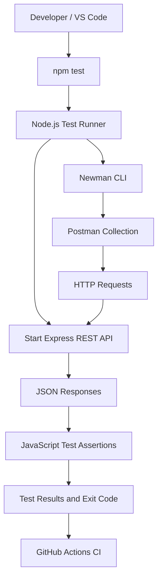
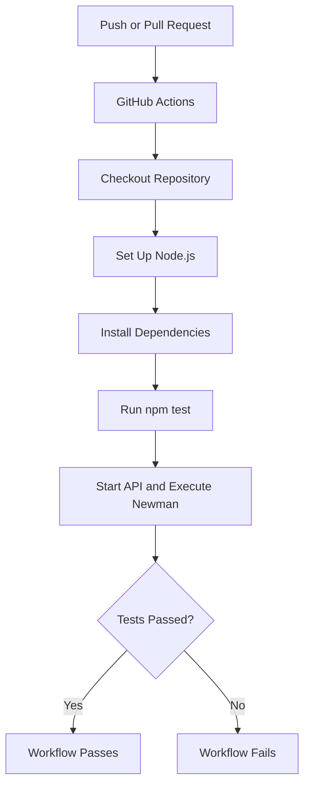

# REST API Testing Framework

An automated REST API testing framework built with **Postman, JavaScript, Newman, Node.js, Express, JSON, and GitHub Actions**. The project demonstrates API test automation, authentication testing, request validation, CRUD workflow verification, response assertions, and continuous integration.

The framework includes a local sample REST API, allowing the test suite to run without depending on third-party APIs or external credentials.

## Table of Contents

- [Project Overview](#project-overview)
- [Key Features](#key-features)
- [Architecture](#architecture)
- [Technology Stack](#technology-stack)
- [Project Structure](#project-structure)
- [Getting Started](#getting-started)
- [Running the Tests](#running-the-tests)
- [Test Coverage](#test-coverage)
- [API Reference](#api-reference)
- [Authentication](#authentication)
- [Continuous Integration](#continuous-integration)
- [Test Execution Workflow](#test-execution-workflow)
- [Design Decisions](#design-decisions)
- [Limitations and Future Enhancements](#limitations-and-future-enhancements)
- [Learning Outcomes](#learning-outcomes)

## Project Overview

Manual API testing can become repetitive and error-prone when validating multiple endpoints, request payloads, authentication scenarios, and response formats.

This project addresses that problem by providing a reusable, automated test suite that verifies API behavior against a locally running REST service.

The framework validates:

- HTTP status codes and response bodies.
- Authentication and authorization failures.
- Required fields and invalid input types.
- JSON response structure and data types.
- CRUD operations and data persistence during a test run.
- Error handling for malformed requests and nonexistent resources.
- Automated execution through Newman and GitHub Actions.

## Key Features

| Feature | Description |
|---|---|
| Automated API testing | Execute a Postman collection through Newman. |
| CRUD testing | Validate create, read, update, and delete workflows. |
| Authentication testing | Verify missing and invalid Bearer tokens. |
| Input validation | Test missing fields, invalid types, and empty values. |
| Response validation | Assert status codes, JSON fields, values, and data types. |
| Environment configuration | Configure the API base URL and token through Postman variables. |
| Dynamic test data | Store the created resource ID for subsequent requests. |
| CI automation | Run the test suite through a GitHub Actions workflow. |
| Self-contained execution | Start the sample API automatically when running `npm test`. |

## Architecture

The framework follows a simple, modular architecture separating the API under test, the test collection, the test runner, and the CI pipeline.



### Architecture Components

**1. Sample REST API — Express**

Implements the endpoints under test, including CRUD operations, Bearer-token checks, input validation, and JSON error responses. The API uses an in-memory data store.

**2. Postman Collection**

Defines the requests, request headers, payloads, test scripts, and assertions. Environment variables provide the base URL, authentication token, and dynamically created resource ID.

**3. Newman Test Execution**

Newman executes the exported Postman collection from the command line, making the same test suite usable locally and in CI.

**4. Node.js Test Runner**

The runner starts the API, waits for the health endpoint to respond, executes Newman, and shuts down the API after the run.

**5. GitHub Actions**

The workflow installs Node.js dependencies and runs the test suite automatically on pushes, pull requests, and manual workflow dispatches.

## Technology Stack

| Technology | Purpose |
|---|---|
| JavaScript | API implementation and test assertions |
| Node.js | Runtime and test orchestration |
| Express.js | Sample REST API server |
| Postman | API requests and test collection |
| Newman | Command-line Postman collection execution |
| JSON | Request payloads, responses, and configuration |
| Git and GitHub | Version control and source hosting |
| GitHub Actions | Continuous integration |
| npm | Dependency and script management |

## Project Structure

```text
RestAPI-Testing-Framework/
├── .github/
│   └── workflows/
│       └── api-tests.yml
├── postman/
│   ├── RestAPI-Testing-Framework.postman_collection.json
│   └── local.postman_environment.json
├── scripts/
│   └── run-tests.js
├── src/
│   └── server.js
├── tests/
│   └── README.md
├── .gitignore
├── package.json
├── package-lock.json
└── README.md
```

### Important Files

- `src/server.js` — REST API routes, authentication middleware, input validation, and error handling.
- `postman/RestAPI-Testing-Framework.postman_collection.json` — Automated requests and JavaScript assertions.
- `postman/local.postman_environment.json` — Local environment variables.
- `scripts/run-tests.js` — API startup, readiness check, Newman execution, and shutdown.
- `.github/workflows/api-tests.yml` — GitHub Actions automation.
- `package.json` — Dependencies and execution scripts.

## Getting Started

### Prerequisites

Install the following:

- [Node.js](https://nodejs.org/) version 18 or newer.
- npm, included with Node.js.
- [Visual Studio Code](https://code.visualstudio.com/).

Verify your installation:

```bash
node --version
npm --version
git --version
```

### 1. Clone the Repository

```bash
git clone https://github.com/Kshitij7498/REST-API-Testing-Framework.git
cd REST-API-Testing-Framework
```

Alternatively, open your existing project folder directly in VS Code.

### 2. Install Dependencies

```bash
npm install
```

### 3. Run the Complete Test Suite

```bash
npm test
```

The command automatically starts the sample API, waits for it to become available, executes the Postman collection using Newman, prints the test results, and stops the API.

A successful run exits with code `0`. Test failures produce a nonzero exit code, allowing CI to detect failed runs.

## Running the Tests

### Option A: Automated Execution

Recommended for normal development and CI testing:

```bash
npm test
```

No separate API terminal is required.

### Option B: Start the API and Run Newman Separately

**Terminal 1 — Start the API**

```bash
npm start
```

The server listens at:

```text
http://127.0.0.1:3000
```

**Terminal 2 — Execute the collection**

```bash
npm run test:collection
```

Stop the server with `Ctrl + C` when finished.

### Option C: Run Through Postman

1. Start the API with `npm start`.
2. Open Postman.
3. Import `postman/RestAPI-Testing-Framework.postman_collection.json`.
4. Import `postman/local.postman_environment.json`.
5. Select the `Local REST API` environment.
6. Run the `REST API Testing Framework` collection.

Run the collection in its existing order because the CRUD workflow stores and reuses the ID of the created resource.

## Test Coverage

The collection includes tests for the following scenarios:

| Test scenario | Expected result |
|---|---|
| Public health check | `200 OK` |
| Request without authentication | `401 Unauthorized` |
| Request with invalid token | `403 Forbidden` |
| Retrieve item collection | `200 OK` |
| Create item with valid payload | `201 Created` |
| Create item without required name | `400 Bad Request` |
| Create item with invalid name type | `400 Bad Request` |
| Retrieve created item | `200 OK` |
| Update existing item | `200 OK` |
| Update item with empty name | `400 Bad Request` |
| Retrieve item using invalid ID | `400 Bad Request` |
| Retrieve nonexistent item | `404 Not Found` |
| Submit malformed JSON | `400 Bad Request` |
| Delete existing item | `200 OK` |
| Retrieve item after deletion | `404 Not Found` |

### Response and Data Validation

JavaScript assertions validate response status codes, JSON properties, primitive data types, returned values, and consistency between the item count and the returned array.

### CRUD Workflow

The collection performs a connected workflow:

1. Create a test item.
2. Save the returned ID in the Postman environment.
3. Retrieve the item and validate its values.
4. Update its name and description.
5. Validate the updated response.
6. Delete the item.
7. Confirm the deleted item returns `404 Not Found`.

This verifies behavior across multiple related requests rather than testing every endpoint in isolation.

## API Reference

Base URL:

```text
http://127.0.0.1:3000
```

All `/api/items` endpoints require a valid Bearer token.

| Method | Endpoint | Description | Success status |
|---|---|---|---|
| GET | `/health` | Health check | `200` |
| GET | `/api/items` | List all items | `200` |
| GET | `/api/items/:id` | Retrieve an item | `200` |
| POST | `/api/items` | Create an item | `201` |
| PUT | `/api/items/:id` | Update an item | `200` |
| DELETE | `/api/items/:id` | Delete an item | `200` |

### Example: Create an Item

**Request**

```http
POST /api/items
Content-Type: application/json
Authorization: Bearer test-token
```

```json
{
  "name": "Framework test item",
  "description": "Created through API automation"
}
```

**Example response**

```json
{
  "data": {
    "id": 2,
    "name": "Framework test item",
    "description": "Created through API automation"
  },
  "message": "Item created"
}
```

The returned ID depends on the current state of the in-memory data store.

### Example: Update an Item

```http
PUT /api/items/2
Content-Type: application/json
Authorization: Bearer test-token
```

```json
{
  "name": "Updated framework item",
  "description": "Updated through API automation"
}
```

### Example: Delete an Item

```http
DELETE /api/items/2
Authorization: Bearer test-token
```

The API returns a success message and the deleted resource ID.

## Authentication

The sample API uses a simple Bearer-token authentication mechanism.

Include this header with protected requests:

```http
Authorization: Bearer test-token
```

The sample API distinguishes between:

- Missing or incorrectly formatted Bearer authentication: `401 Unauthorized`.
- A supplied but invalid token: `403 Forbidden`.

The token is intended only for local demonstrations. It is not a production authentication system.

## Continuous Integration

The workflow in `.github/workflows/api-tests.yml` automates API test execution through GitHub Actions.

### CI Pipeline



### Pipeline Benefits

- Repeatable test execution after code changes.
- Early detection of regressions.
- Automated verification without manually opening Postman.
- A nonzero test-runner exit code signals failure to the CI system.

To inspect the results, open the repository's **Actions** tab after pushing a commit.

## Test Execution Workflow

The complete execution lifecycle is:

1. The developer runs `npm test`.
2. The Node.js runner starts the Express API as a child process.
3. The runner polls `/health` until the API responds or the startup timeout expires.
4. Newman loads the Postman collection and local environment.
5. Each request is sent to the local API.
6. JavaScript test scripts validate the responses.
7. Newman returns an exit code based on the test results.
8. The runner shuts down the API process.

This design allows local execution and CI execution to use the same test collection.

## Design Decisions

**Local API instead of a third-party service**

A self-contained API avoids external service availability, rate limits, and credentials during test execution.

**Postman collection as the test definition**

Requests and assertions are maintained in an importable collection that can be executed in Postman or Newman.

**Environment variables**

The base URL, authentication token, and dynamically generated item ID are configurable without hardcoding the resource ID into every request.

**Nonzero failure exit code**

Failed assertions can fail the CI workflow instead of silently reporting success.

**In-memory data storage**

The sample API stays lightweight and easy to run. Data is reset when the server restarts, so it is not intended to demonstrate persistent database behavior.

## Limitations and Future Enhancements

The current implementation focuses on API testing fundamentals. Possible next improvements include:

- Add reusable assertion utilities and common test helpers.
- Generate HTML or JSON test reports as CI artifacts.
- Add request-duration thresholds and performance checks.
- Expand schema validation using JSON Schema and Ajv.
- Add pagination, filtering, sorting, and boundary-value tests.
- Add rate-limiting and security test scenarios.
- Introduce a persistent database and isolated test fixtures.
- Add environment-specific configuration for development and staging.
- Add linting and code-quality checks.
- Expand CI to test supported Node.js versions.

These are proposed enhancements, not features currently implemented.

## Learning Outcomes

This project demonstrates practical experience with:

- REST API fundamentals and HTTP methods.
- Positive and negative test-case design.
- HTTP status codes and JSON response validation.
- Authentication and input-validation testing.
- Automated CRUD workflow testing.
- Postman test scripts and Newman execution.
- Node.js process orchestration.
- Git, GitHub, and continuous integration.
- Structuring a reusable API testing project.

## Author

**Kshitij Raghatate**

- GitHub: https://github.com/Kshitij7498
- LinkedIn: https://www.linkedin.com/in/kshitij-raghatate-a39722275/
- LeetCode: https://leetcode.com/u/kshitij_raghatate/

---

If you find this project useful, consider giving the repository a star.

**Project repository:** https://github.com/Kshitij7498/REST-API-Testing-Framework
